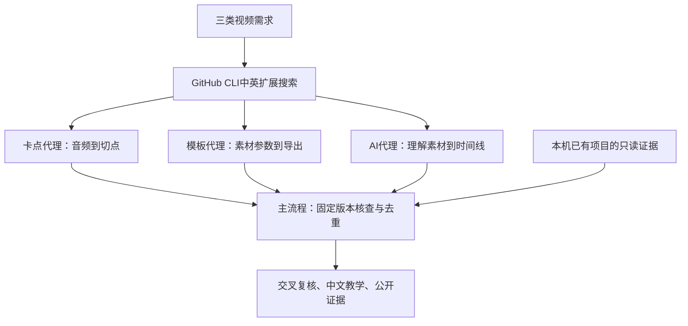

# AI剪辑、卡点混剪与可复用模板：中文调研与学习手册

**针对你现有项目，优先继续用HyperFrames，并复用已有Herk、video-shotcraft和montage能力。其他仓库用于补镜头配方、素材参数和可编辑时间线；下表按用途组织，不代表它们整体优于HyperFrames。**

后续补核：[从其他项目学习什么](docs/10-learn-with-hyperframes.md)、[OpenChatCut与本机工具怎样集成](docs/11-openchatcut-integration.md)、[桌面源码第一课](docs/12-openchatcut-first-lesson.md)、[安装与启动第二课](docs/13-openchatcut-startup.md)。OpenChatCut已在Windows完成依赖安装、隔离服务启动与浏览器编辑器验证，附中文命令解释、启动/停止脚本和实际截图；AI剪辑、导出及HyperFrames联动尚未实测。

这份仓库为不熟悉命令行和编程的人编写。除了项目名单，还解释“为什么推荐”“凭什么判断”“命令做了什么”“哪些说法尚未验证”。研究日期为 **2026年11月4日，Asia/Shanghai**。

本次使用已登录的 **GitHub CLI（gh）** 搜索与读源码。主流程为 GPT-6 Astra，三个并行子代理为 GPT-6.1 Sol、high；主流程做综合复核，另安排一次交叉检查。

## 先选你的任务

| 我想做什么 | 先看哪个项目 | 真正能拿来用什么 | 先知道的限制 |
|---|---|---|---|
| 电影/情绪卡点混剪 | [easyedit](https://github.com/blixvip/easyedit) | 真实节拍分析、镜头编排、HTML/JS视觉模板、本地素材入口 | 偏“台词→混剪→主角收尾”的结构；未在本轮试跑 |
| 学习最小卡点流程 | [beat-synced-edit](https://github.com/ZiadAbdelkarim/beat-synced-edit) | 音频分析→剪辑清单→FFmpeg；另有JSON白闪模板 | 白闪模块按配置时长，并非自动听歌；主渲染需验证短源片对齐 |
| 照片卡点/婚礼相册 | [VVV](https://github.com/actionow-ai/vvv) | 已有模板、图片/文案/音乐参数、beat map | 作者完整验证环境偏macOS；Windows未在本轮测试 |
| 换字、换图、换品牌的动效 | [Opus30](https://github.com/lumian2015/opus-5-5-video-templates) | 30个HTML模板、变量替换工具；25号为六图产品reel | 预设节奏，换音乐可能要重调剪点 |
| 照片与视频批量混排 | [slideshow](https://github.com/feliperun/slideshow) | project.json、音乐分析、预览与渲染流程 | 仓库较小；Windows原生依赖需试验 |
| 对话改片＋保留时间线 | [OpenChatCut](https://github.com/0xsline/OpenChatCut) | 用户素材、节奏分析、卡点工具、可编辑工程 | 软件栈较大，AGPL-3.0；完整流程尚待运行验证 |
| 中文口播/访谈剪辑 | [FunClip](https://github.com/modelscope/FunClip) | 按文字/说话人选段、可选LLM高光 | 语音剪辑不等于音乐卡点 |
| 删除静音、先做粗剪 | [auto-editor](https://github.com/WyattBlue/auto-editor) | 按音量等规则剪辑与时间线导出 | 不是语义高光模型；当前已为Nim实现，不照搬旧pip教程 |
| 产品发布片 | [官方HyperFrames launches](https://github.com/heygen-com/hyperframes-launches) / 已有[video-shotcraft](https://github.com/Vincentwei1021/video-shotcraft) | 完整动效工程、镜头卡、可替换品牌结构 | 代码、字体、音乐、品牌素材的许可要分别看 |
| 要在剪映里继续改 | [cutcli-cookbook](https://github.com/xuliang2024/cutcli-cookbook) | 公开配方和草稿JSON示例 | 配方MIT，但依赖的核心cutcli/jy_cli闭源；导入导出需实测 |

上表用于决定先研究谁，不承诺“安装即出好片”。首轮26项详细对比及115条固定提交证据见[完整审查目录](docs/03-reviewed-catalog.md)；后续HyperFrames基线与OpenChatCut接口补核另见上方专题。

## 这次到底做了多少工作

| 项目 | 数量 | 正确解读 |
|---|---:|---|
| 中英扩展查询 | 28 | 每条最多取一页30条，保留原始响应 |
| 搜索取回记录 | 598 | 同一仓库可能重复出现 |
| 按GitHub仓库id去重 | 555个 | 合并43次重复命中 |
| 指定仓库补漏新增身份 | 2个 | 与搜索池合并，目录共557个仓库 |
| 重点静态源码审查 | 26个 | 读文档、依赖、许可、实际实现；并非全555个都深审 |
| 固定提交源码证据 | 115条 | 可以跳到本次看到的版本 |
| 明确排除/降级记录 | 27项 | 含关键词噪声、来源重复、许可/平台或任务不匹配 |
| 首轮新候选软件运行测试 | 0 | 首轮仅静态审查；后续已补OpenChatCut安装与界面启动验证，见第二课 |

另对本机已有项目做了只读核验，主流程复查两个现成MP4的媒体元数据和关键脚本。它与新候选软件测试是两件事。

数据见[统计JSON](evidence/statistics.json)、[28条查询执行清单](docs/09-query-log.md)、[557个候选目录](docs/08-all-candidates.md)。原始API的`total_count`不是已读取、已审查数量。

## 如果你没有基础，按这个顺序读

1. **先看这页的用途表。** 选择一种视频，不必同时学所有工具。
2. **读[零基础CLI教程](docs/02-cli-guide.md)。** Git和gh区别、查询语法、JSON、文件树、固定版本、去重、发布命令都有逐项解释。
3. **读[当前项目洞察](docs/06-current-project-insights.md)。** 了解你已经具备什么，以及为什么下一步更值得补模板入口与质检。
4. **读与你方向对应的分支报告。** [音乐卡点/情绪混剪](reviews/beat-montage.md)、[纯模板/可换素材](reviews/editable-templates.md)、[AI素材剪辑](reviews/ai-editing.md)。
5. **查证据与练习。** [完整对比](docs/03-reviewed-catalog.md)、[去重/排除](docs/04-dedup-and-exclusions.md)、[学习路径与术语](docs/07-learning-path.md)。

## 几个最值得记住的结论

**“跟随音乐”有几种不同实现。** 真实音频检测、按给定BPM铺网格、按预写时间点播动效、只做频谱可视化，不能混称同一个功能。例如beat-synced-edit的主流水线检测节拍，其白闪模块却只读取JSON时长。[具体源码证据](reviews/beat-montage.md)

**模板数量不等于独立能力数量。** html-video的NOTICE列出8个来自HyperFrames registry的模板与1个来自student-kit的模板；抽查还发现有静态风格底稿。不能把这些再全部算成新的、完整的动效模板。[模板审查及来源](reviews/editable-templates.md)

**高星AI视频项目可能解决另一类任务。** MoneyPrinterTurbo适合主题解说/配音素材合成，不能因为支持本地素材就说它已经会音乐卡点或语义高光。新版也有可重渲染的revision工程，不能沿用“只有MP4”的旧概括。[AI审查](reviews/ai-editing.md)

**“公开源码”与“许可宽松”不能混用。** montage-ai实际为PolyForm Noncommercial；Shotstack模板为PolyForm Shield；Remotion依赖采用独立许可。GitHub的`NOASSERTION`也不等于没有LICENSE，例如Herk的实际主体许可为MIT。[许可逐项记录](docs/03-reviewed-catalog.md)

**你的当前环境已经有成片能力。** 本机已有音频分析、镜头表、变速、帧级时间线与输出文件；优先补语义选镜、模板参数化和验收闭环。还发现一个少1帧的20秒导出，以及一个只抽到开头约1秒的“全片质检拼图”脚本问题。[脱敏案例与证据边界](docs/06-current-project-insights.md)

## 研究怎么推进



[研究方法](docs/01-method-and-workflow.md)记录筛选标准和动态调整；[执行日志](docs/05-execution-log.md)记录做过的操作、异常与处理、验证范围。报告展示可复查的依据和取舍，不用无法核验的主观评分制造确定感。

## 你可以自己复算

只想验证去重数字，不联网：

```powershell
# 在此仓库根目录的PowerShell 7中运行
pwsh -NoProfile -File .\scripts\Merge-Candidates.ps1
```

想重新搜索一条，并合并刚取回的数据：

```powershell
$run = & .\scripts\Search-GitHub.ps1 -MaxQueries 1
& .\scripts\Merge-Candidates.ps1 -RawDirectory $run.raw_directory -OutputFile (Join-Path $run.run_directory 'merged.json')
```

想只读采集指定仓库资料：

```powershell
pwsh -NoProfile -File .\scripts\Get-RepoSnapshot.ps1 -Repository 'ZiadAbdelkarim/beat-synced-edit'
```

重跑结果写进`replay/`，不会覆盖这次研究快照。动态星数、维护时间与默认分支会变；分析某一结论时优先打开本仓库给出的固定SHA链接。脚本不会替你安装或执行候选剪辑软件。

## 仓库内容

```text
README.md                   中文入口与推荐速览
docs/                       方法、CLI、目录、去重、日志、项目洞察、学习路径
reviews/                    三个分支的详细审查报告
evidence/search/raw/        28份公开GitHub搜索原始响应
evidence/search/queries.json 查询、数量、原始文件的映射
evidence/catalog.json       全部557个身份与审查状态
evidence/reviewed-projects.json 26项结构化审查与固定源码证据
evidence/local-audit.json   脱敏的本机观察与验证边界
scripts/                    可复跑搜索、去重、快照采集脚本
```

本仓库保存调研文字、公开元数据、证据链接和调研脚本；上游项目及媒体适用各自许可。没有搬运候选项目的整套源码、影视素材、音乐或成片。

建议的下一步：选择一个新增模板，用同一批自有素材与现有流程做30秒对照样例，记录操作次数、帧数、节拍、视觉观感及可编辑性。这个对照实验尚未执行。
