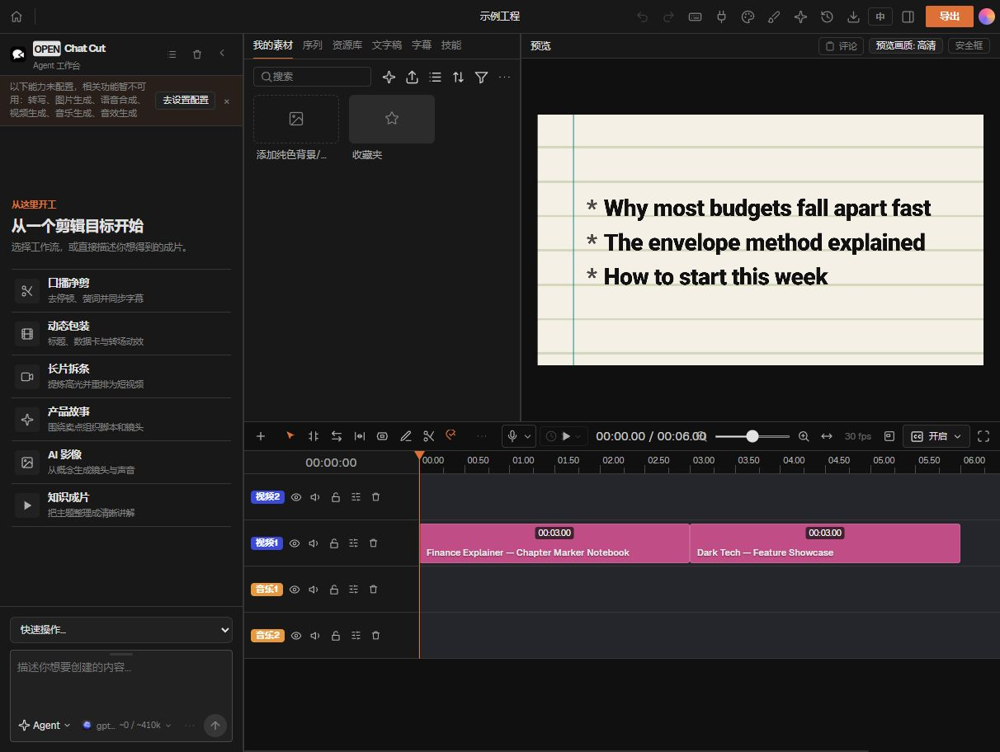

# 第二课：把桌面上的 OpenChatCut 真正启动起来

本课记录 2026 年 11 月 4 日的实际操作。结果：OpenChatCut 0.2.17 已安装依赖，服务监听 `127.0.0.1:5199`，中文工程列表和示例工程编辑器均已打开。停止、重新启动后仍能进入工程。这个结论只覆盖本地启动与界面加载，没有把 AI 剪辑、音乐分析或视频导出算作已验证。



## 你以后最常用的两个命令

在 PowerShell 中运行：

```powershell
cd "$env:USERPROFILE\Desktop\OpenChatCut-main"
.\Start-OpenChatCut.ps1
```

然后打开 **http://127.0.0.1:5199/**。

- `cd`：进入项目文件夹。
- `$env:USERPROFILE`：当前 Windows 用户目录，不必把用户名写死。
- `.`：当前文件夹；`.\Start-OpenChatCut.ps1` 表示运行当前文件夹里的启动脚本。
- `.ps1`：PowerShell 脚本，把这次已经验证的几个步骤保存起来，以后重复使用。

这两个脚本已经复制到桌面源码文件夹。仓库也保留了 [启动脚本](../scripts/Start-OpenChatCut.ps1) 和 [停止脚本](../scripts/Stop-OpenChatCut.ps1)。其他人复用时，应先检查自己的源码位置与 Node 环境。

启动脚本会在当前终端持续运行。**保持终端打开**；在该终端按 `Ctrl+C` 可以结束服务。也可以另开一个 PowerShell：

```powershell
cd "$env:USERPROFILE\Desktop\OpenChatCut-main"
.\Stop-OpenChatCut.ps1
```

停止脚本先检查 5199 端口对应的进程确实属于这份 OpenChatCut，再停止它。关闭浏览器标签页不等于停止服务；停止服务也不会删除视频工程。没有设置 Windows 开机自启。

## 这次实际经过了哪些步骤

| 步骤 | 操作 | 实际证据与解释 |
|---|---|---|
| 1. 确认版本 | 读取 package.json，运行 node --version、npm.cmd --version | 项目要求 Node >=24 <25；原有 Node 24.22.2、npm 11.19.1 |
| 2. 首次安装 | npm.cmd ci --no-fund | 失败：当前 Node 无法创建 node_modules，报 EPERM |
| 3. 区分问题范围 | 分别用 PowerShell 与两套 Node 写入小测试文件 | PowerShell 可写；原有 Node 在桌面、临时目录、工作目录都失败；另一套 Node 24.22.1 可写 |
| 4. 用可工作的运行环境安装 | Node 24.22.1 运行已安装 npm 的 npm-cli.js ci --no-fund | 退出码 0，新增 847 个包，审计 848 个包 |
| 5. 准备配置 | 从 .env.example 复制 .env.local | 原先不存在配置文件；复制的是空密钥模板 |
| 6. 准备资源 | sync:mediapipe、sync:whisper-cli、verify:server-tool-catalog | 三项均成功；模型校验通过，Whisper CLI 就绪，工具目录一致 |
| 7. 检查原生组件 | FFmpeg 版本、esbuild 实际转换、ONNX Runtime 导入 | 均成功，不仅检查文件夹是否存在 |
| 8. 排除 ZIP 启动障碍 | 创建本地 Git 元数据，使用官方隔离启动入口 | 原先没有 .git；官方 dev-profile 需要 Git 路径 |
| 9. 排除重启循环 | 采用官方默认隔离数据目录 | 避免普通模式反复写 .env.local 引起 Vite 重启 |
| 10. 验证交付 | 用交付的停止/启动脚本实际重启，访问网页与示例工程 | HTTP 200；中文首页、预览、时间线加载；捕获的浏览器 error 日志为空 |

证据汇总见 [启动验证 JSON](../evidence/openchatcut-startup-validation.json)。它是此前“仅静态审查”之后的新阶段，未覆盖或改写初始研究快照。

## 安装命令到底做了什么

通常先运行：

```powershell
npm.cmd ci --no-fund
```

`npm` 是依赖管理工具，`ci` 根据 `package-lock.json` 的锁定版本安装，生成 `node_modules`。`--no-fund` 只是不显示依赖的赞助提示。Windows 使用 `npm.cmd` 可避免命中受到 PowerShell 执行策略限制的 `npm.ps1`。

**注意：ci 会重新建立依赖目录，不是每次打开软件都要运行的命令。** 本轮开始时还没有 node_modules。以后正常使用只运行启动脚本。

这台机器上，原有 Node 24.22.2 的文件写入失败，具体系统原因尚未确定；不能据此断言所有 24.22.2 都有问题。没有修改系统 ACL、杀毒设置或全局 Node。实际成功的安装方式是：

```powershell
$node = "$env:USERPROFILE\.cache\codex-runtimes\codex-primary-runtime\dependencies\node\bin\node.exe"
$npmCli = "$env:USERPROFILE\Apps\node\node_modules\npm\bin\npm-cli.js"
$env:PATH = "$(Split-Path -Parent $node);$env:PATH"
& $node $npmCli ci --no-fund
```

- `$node`、`$npmCli` 是保存路径的变量。
- `&` 是 PowerShell 的调用运算符，用保存的路径执行程序。
- 这里让已验证可写的 Node 24.22.1 执行 npm 的 JavaScript 入口。
- `PATH` 告诉子进程去哪里找 `node` 等程序；这里只影响本次进程及其子进程。
- 这个 Codex 运行时路径属于本机现有环境，其他电脑不一定存在。启动脚本也会检查普通 PATH 中的 Node 24，但不保证未来 Codex 更新后原路径始终存在。

## 为什么不能只看到“安装成功”就结束

本次 npm 还给出了两类提示：

1. **38 项依赖安全问题：23 moderate、14 high、1 critical。** 这是 npm 对当前依赖树的报告，不等于已证明本地编辑器被攻击，也不等于可忽略。未执行 npm audit fix 或强制升级，以免改变锁定的兼容组合。后续升级应单独审查。本轮服务只绑定本机回环地址。
2. **8 个安装脚本条目尚未被 allowScripts 覆盖。** 核查后发现，相关关键 Windows 二进制已经存在；实际执行 FFmpeg、esbuild 转换和 ONNX 导入均通过。因此没有进行一键全部放行。Windows 安装包制作、其他模型与第三方 AI SDK 的完整能力未测试。

这些结果说明：安装命令的退出码、运行组件是否可用、网页能否打开，是不同层次的证据。

## 启动前的三个准备步骤

项目在 package.json 的 predev 中定义了三个步骤，本次已分别执行：

```powershell
& $node $npmCli run sync:mediapipe
& $node $npmCli run sync:whisper-cli
& $node $npmCli run verify:server-tool-catalog
```

- **MediaPipe**：复制浏览器计算使用的 WASM 文件，下载两个小型图像模型，并核对大小与 SHA-256。不是下载全部 AI 剪辑模型。
- **Whisper CLI**：准备本地语音识别程序。程序与语音模型是两回事，本次没有下载用于转写的模型权重。
- **工具目录检查**：确认软件提供给 Agent 的工具定义与源码一致。成功输出是 `server tool catalog is current`。

交付脚本会用选定的 Node 直接执行这些同样的项目入口，随后执行 `scripts/dev-profile.mjs`；这样避免嵌套 npm.cmd 再次选到本机那套写入失败的 Node。

## 两个真正挡住启动的问题

### ZIP 源码没有 .git

官方开发启动器会运行 `git rev-parse`，取得当前仓库的位置。下载 ZIP 后只有源码，没有 Git 元数据，所以本次执行：

```powershell
git init
```

它建立当前文件夹的本地版本管理元数据。`.git/openchatcut-dev-profile.json` 随后记录这份源码对应的隔离 profile。源码目录没有被作为一个新仓库推送到 GitHub；公开调研仓库是另一个目录。

### 普通模式反复写配置，导致黑屏

首次尝试项目提供的 dev:shared 对应 Vite 入口时，页面只返回了 HTML，编辑器却没有正常加载。日志反复出现 `.env.local changed, restarting server...`。

源码链条是：xAI 登录初始化在没有会话时也清空一个设置项，setKeys 每次都重写配置文件；普通模式把设置存进 `.env.local`，Vite 看到它改变就重启。再次启动又重复同样的动作。

最后使用项目原生隔离模式，把设置放到源码目录外。还核查出：本版本自定义 OPENCHATCUT_DATA_DIR 时，官方 wrapper 的读取位置与服务端写入位置可能不同。因此本轮采用原生默认位置，不保留该覆盖值。

源码依据：

- [dev-profile 的 Git 路径与设置载入](https://github.com/0xsline/OpenChatCut/blob/7fa4b7903e7ebecf832a36249f0c0c755200cc17/scripts/dev-profile.mjs)
- [普通/隔离 profile 的数据路径](https://github.com/0xsline/OpenChatCut/blob/7fa4b7903e7ebecf832a36249f0c0c755200cc17/server/runtime-profile.ts)
- [xAI 初始化](https://github.com/0xsline/OpenChatCut/blob/7fa4b7903e7ebecf832a36249f0c0c755200cc17/server/xai-oauth-session.ts)
- [设置写入](https://github.com/0xsline/OpenChatCut/blob/7fa4b7903e7ebecf832a36249f0c0c755200cc17/server/keystore.ts)

## 最后的启动命令与文件位置

准备步骤完成后，核心启动命令是：

```powershell
& $node .\scripts\dev-profile.mjs --host 127.0.0.1
```

`--host 127.0.0.1` 表示只在本机提供服务。浏览器是操作界面，Node 进程是后台程序；这个地址不是发布到公网的网站。

| 文件或目录 | 用途 |
|---|---|
| 桌面/OpenChatCut-main/src | 软件界面和剪辑逻辑的源码 |
| 桌面/OpenChatCut-main/node_modules | 安装下载的依赖 |
| 桌面/OpenChatCut-main/.env.local | 最初复制的配置模板；不要公开密钥 |
| 桌面/OpenChatCut-main/.git/openchatcut-dev-profile.json | 这份源码的隔离 profile 标识 |
| 用户目录/.openchatcut/dev-profiles/对应标识/ | 最终实际使用的数据目录 |
| 上述数据目录/settings.env | 隔离模式下的运行设置；不要公开 |
| 桌面/OpenChatCut-data | 排查普通模式时产生的测试目录；最终启动方案不使用它 |

不需要管理员 PowerShell，不需要每次安装依赖，也不需要每次 git init。启动脚本会显示所选 Node 和本机地址；若已经运行，会提示直接打开网页。

## 现在已经验证什么，下一课才做什么

已经验证：安装、资源准备、关键原生模块、首页、示例工程编辑器、预览画面、时间线显示，以及停止后再启动。截图中的内置示例为 6 秒、30 fps；只是软件自带示例，不是替用户制作的新片。

仍有一个上游 Windows 预热路径提示：`/@fs/src/main.tsx` 找不到。实际 `/src/main.tsx` 请求成功，页面随后完整加载。本次没有修改这个预热优化；也没有把“页面能开”写成“所有功能都无错误”。

尚未验证：AI 对话请求、BeatThis/CLAP 音乐模型、实际视频导入与导出、MCP 连接、HyperFrames 画面集成。左侧“能力未配置”提示与安装成功并不矛盾。下一课可从导入一段短视频、一段音乐、手动分割片段开始，再加入自动卡点。
