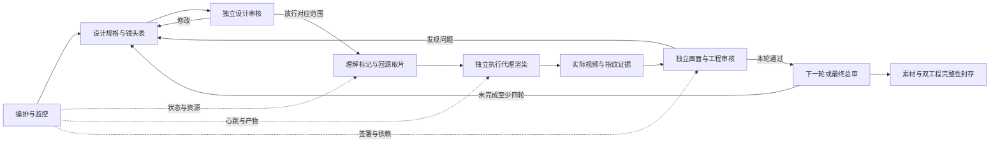

# 从全季素材到一分钟混剪：操作与学习

这次把第一季素材理解、剪辑设计、独立审核和执行分开。你以后换素材，可以复用流程和代码；人物位置、动作时机、源切口与抠像仍要重新观察。当前记录不代表模型权重被训练，也不代表电脑理解了全部对白和剧情。



## 1. 先知道手里的素材是什么

原片位于`D:/咒术回战/1080P 内嵌简中字幕`，编号01–24，均为1920×1080、24000/1001fps、BT.709 SDR。另有02(1)、05(1)，完整SHA256分别与正本相同，所以只索引一次，没有删除文件。机器清单在`data/source-inventory.json`。

目录名不能证明季数。素材代理实际看了24集各8张导航；审核员另看第一集与末集。然后在动作密集段看13组共312张静帧，标记97个候选，取回58段低清审片、各看4个时点。一次静帧曾把三轮跃起错认成真希，短序列复查后纠正；这说明标记必须保留证据和修订，不能把名称写上就当事实。

```powershell
$s1Root = 'D:/gpt/2026-11-04/ps-c-windows-system32-winget-install-2/outputs/jjk-s1-workflow'
$s1Py = 'C:/Users/PC/.cache/codex-runtimes/codex-primary-runtime/dependencies/python/python.exe'
$s1FFprobe = 'C:/Users/PC/Apps/ffmpeg/bin/ffprobe.exe'
& $s1FFprobe -v error -select_streams v:0 -show_streams -of json 'D:/咒术回战/1080P 内嵌简中字幕/01.mp4'
```

`ffprobe`只读流信息；`-select_streams v:0`选第一条视频，`-of json`使结果可被程序检查。不要把音频容器时长、视频流时长和实际可解码帧数混为一个字段。

## 2. 60Hz JPG与23.976fps原片的关系

每秒60个采样点是`t=n/60`。程序从同一次FFmpeg解码的showinfo取得真实整数PTS，再选在该时刻正在显示的最近前帧。原片每秒约24帧，同一源帧通常会对应2或3个JPG路径。这些重复不是光流或AI插值，不增加动作细节。

比如第一集300秒的采样是F18000，对应原生帧7192、源PTS约299.966333秒，与F17998共享相同JPG字节。文件依然能按各自名字正常打开。NTFS硬链接共享一份数据；如果你要单独改某一张，请先复制为新的独立文件，避免修改同一硬链接数据。跨磁盘复制通常会变成独立副本，占用会增加。

检索图为640×360、FFmpeg JPEG q6，保留原画面比例与内嵌字幕。它用于看图、标记、检索；正式成片回1920×1080原视频取片。不能从这批有损缩略图反向得到原画质。

```powershell
& $s1Py -X utf8 "$s1Root/scripts/library-query.py" --episode 1 --time 300
```

此命令查SQLite索引，返回JPG绝对位置、真实源帧、PTS、重复标记和附近有证据的人工候选。没有人工候选时，语义保持未知；机器每秒测得的亮度/颜色不能证明人物身份或动作方向。

## 3. 把“大批处理”做成可恢复任务

全季约206万个JPG路径。先做10秒试样，再做第一集；第一集实际约93秒提取，34,406个唯一JPEG映射86,102个采样路径，JPG数据约617MiB。这个实测比只用一张照片估算更有用，但仍不是所有集的大小上限。

```powershell
& $s1Py -X utf8 "$s1Root/scripts/extract-library.py" --require-design-pass --episodes S1E01 --workers 1
& $s1Py -X utf8 "$s1Root/scripts/extract-library.py" --require-design-pass --workers 2
```

这是本次真实执行的阶段命令。第一集通过独立审核后才执行全季。再次运行时，已完成集会核对源指纹、配置指纹、数据库连续性、磁盘数量和抽样解码；未完成集从头重做，属于按集恢复，不是从任意单帧续写。只写本任务输出目录，原片保持只读。

每集的`progress.json`记录raw提取状态，`index.sqlite`保存原生PTS和60Hz映射，`samples.jsonl`提供逐行可读导出。文件按`S1E编号/minute-编号/F采样号.jpg`分桶，避免把200万个文件放在一个目录。硬链接失败会复制并记录，不会跳过一个采样路径。

空闲磁盘低于80GiB会停止任务；每约5秒写心跳。`workflow/monitor.json`显示当前集数、总采样数与异常，`events.jsonl`保存状态变化。心跳超过180秒不动会产生告警，由编排层调查、决定重试，不能把错误状态改成完成。

```powershell
& $s1Py -X utf8 "$s1Root/scripts/workflow.py" status
& $s1Py -X utf8 "$s1Root/scripts/workflow.py" check-review --review 'reviews/设计审核.json'
```

第二条会重新计算被审核文件的SHA。设计或配置改了，旧签署就不能继续冒充针对新文件的批准。

## 4. 提取完成与完整性校验是两件事

提取时每分钟解码首、中、尾JPG，这是抽检。正式素材验收另外运行：

```powershell
& $s1Py -X utf8 "$s1Root/scripts/verify-library.py" --watch --workers 4
```

校验器逐张完整解码所有唯一JPEG并核对SHA，逐个检查所有60Hz路径的文件ID或复制字节、PTS区间、连续编号和磁盘数量。重复路径共享已解码的同一图像；它不重复做无意义的像素解码，但每个别名都检查。通过后每集才有`verification.json`。全季通过要看`data/library-verification.json`的24集总计，不能把第一集通过扩写成全季通过。

机器能证明文件、时钟和指纹一致，不能证明所有画面语义都标对，更不能证明剪辑好看。

## 5. 从标记调度素材

`data/shot-candidates.json`保存静帧锚点，`retrieval-candidates.json`保存短序列预检后的保守核心窗口。人物/姿态、景别、主色、抠像可行性、证据图与置信等级分开写。`unknown_from_single_frame`表示单帧不足以判断运动方向；不会硬填“向左”来满足表格。

执行代理读取镜头设计，再回原视频取片，核对原切与首中尾。原计划的5处重慢放经审核提出风险，执行阶段扩大同源动作窗口或换镜；不能把一串重复帧当作流畅的慢动作。具体旧新值与取回证据写进对应loop。

主参考本次等概率抽到V20，结果只抽一次。V20强调伸手/挥臂/飞跃动作相位、屏中画面和段落停顿。因此这支片的设计不是把18类手法全部塞满，而是先让手、眼和身体方向接上，再补空间、字与遮挡。

## 6. 四轮各自解决什么

|轮次|实际执行重点|独立审核重点|
|---|---|---|
|1|完整60秒基础动作粗剪，所有片段回源|人物/动作是否错配，隐切、过度慢放、手与眼的焦点跳动|
|2|屏中换片、真实动态青掌、窄缝、七叶、曲面字与裂边|图层顺序、alpha边缘、关键词、同源时钟和衔接|
|3|按发现修订后的全片高质量渲染|一分钟的密度/呼吸、全尺寸边缘、源裁切、完整解码和音频对齐|
|4及以后|按上一轮具体发现真实修改，制作最终包|每项整改有证据，检查退化、工程重开与交付完整性|

每轮必须保留不同的实际视频、计划、执行者、审核者、视频SHA和修订diff。执行者不能批准自己的成片；轮数达到4也不能自动通过。`scripts/workflow.py seal`会拒绝素材未完整、缺文件、审核过期、四个视频实际相同或末轮未通过的封存。

## 7. 本片音乐为什么这样处理

本次新片沿用曲库规则，选用抽中V20对应的music-candidate。它实解码为30.6735625秒；用户明确要求一分钟，所以同一乐段复用两次，重叠64662采样/1.347125秒，输出48kHz双声道、2,880,000采样、60秒。选段和处理详`music/music-report.json`。

`music/onsets.json`由10ms跳步的频谱变化得到起音候选，再量化至24fps；起音、强拍、歌词重音并非一回事。制作没有实际听觉试听，分离残留、乐句拼接和情绪听感不能只凭数值声明通过。它也没有换用上一支第二季片的edge.mp3。

## 8. 修改应去哪里

OpenChatCut原生序列负责逐镜顺序、入点、基础裁切、音乐与学习小字；HF插片序列保留完整效果，但段内人物与字已合成。复杂抠像、字形、屏框、撕边与布局回HyperFrames源码修改，再重渲受影响72帧段并替换OCC插片。两边没有自动双向同步。

HyperFrames普通预览用视频，离线精确渲染用同号源帧PNG。字体和字形路径需随包带走，曲面SVG不能靠修改隐藏文字就自动重建。第一季的有效画面带是y60–1019，与旧第二季V2的y108–971不同，复用代码必须改裁切边界。

最终操作入口和验收数字以主README及本次最终质量报告为准；本文记录流程原理和已发生的准备动作，不替代后续逐轮签署。
